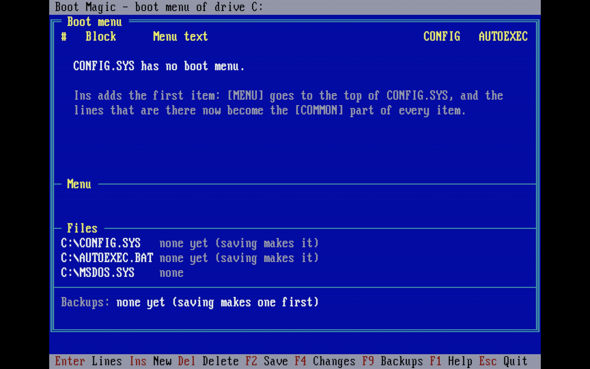

# BMAGIC – Boot Magic, a boot menu editor for DOS

Boot Magic (`BMAGIC.EXE`, about 64 KB) edits the boot menu of MS-DOS 6 and later. It reads `CONFIG.SYS`, `AUTOEXEC.BAT` and `MSDOS.SYS` in the root folder of the boot drive, maps the menu in them (the `[MENU]` block, the block of each item in `CONFIG.SYS`, and its section after `GOTO %CONFIG%` in `AUTOEXEC.BAT`), and lets you add, edit, copy, rename, move and delete menu items, edit their lines, and set the default item, the timeout, the colors and NumLock. It also sets the startup options of a Windows 95/98 `MSDOS.SYS`. It changes only the lines it has to change. Before every save it backs up the files and shows what it will change in a diff; any backup can be compared with the files on the disk or restored.



## Files

| File | Purpose |
|---|---|
| `BMAGIC.EXE` | The program. |
| `BACKUP\001\`, `\002\`, ... | *Made at runtime*, in the folder of `BMAGIC.EXE`: the backups (copies of the boot files and a `SET.INI` with the date and a note). |
| `SOURCE/` | Source code (C++, Open Watcom, 16-bit DOS), in layers (see [Structure](#structure)). |
| `SOURCE/build.sh` | Build script (macOS / Linux). |
| `SOURCE/test/` | Unit tests on the host and screen tests in DOSBox (see [Tests](#tests)). |

## Installation

- **With DOSINST**: install `BMAGIC` from the [DOSINST](https://git.teletypegames.org/dos/dosinst) program store. With the default `DEST`, it goes to `C:\APPS\BMAGIC`. An update keeps the backups (DOSINST keeps files it did not install); removing it with DOSINST deletes the folder, the backups too.
- **By hand**: copy `BMAGIC.EXE` to any folder, for example `C:\APPS\BMAGIC\`.

Then start it with `C:\APPS\BMAGIC\BMAGIC`, or add the folder to the `PATH` and type `BMAGIC`.

```
BMAGIC        the boot files of the boot drive
BMAGIC D:     the boot files of another drive (for example a disk you prepare)
```

The boot drive comes from DOS (DOS 4.0 and later). If DOS cannot tell, Boot Magic uses `C:`. In DOSBox, give the drive (`BMAGIC C:`), because DOSBox does not boot from these files. The exit code is 0 when files were written (saved or restored), 1 when nothing was written, and 2 on an error.

## The boot menu

```
CONFIG.SYS                          AUTOEXEC.BAT
  [MENU]                              @ECHO OFF
  MENUITEM=NORMAL,Normal start        PATH C:\DOS        <- every configuration
  MENUITEM=GAMES,Games (EMS)          GOTO %CONFIG%
  MENUDEFAULT=NORMAL,10               :NORMAL
  MENUCOLOR=15,1                      LH SMARTDRV
  NUMLOCK=OFF                         GOTO END
                                      :GAMES
  [COMMON]                            LH MOUSE
  DOS=HIGH,UMB      <- every item     GOTO END
                                      :END
  [NORMAL]
  DEVICE=C:\DOS\HIMEM.SYS
  [GAMES]
  DEVICE=C:\DOS\HIMEM.SYS
  DEVICE=C:\DOS\EMM386.EXE RAM
```

An item is a `MENUITEM` line of `[MENU]`, a `[NAME]` block in `CONFIG.SYS`, and a section in `AUTOEXEC.BAT` that starts at the `:NAME` label and ends at the next label. DOS sets `CONFIG` to the name of the chosen item, and `GOTO %CONFIG%` jumps to its label. The sections end with a `GOTO` to a common label, the *end label* (`:END` unless the file uses another one).

Boot Magic keeps to these rules when it changes the files:

- **New item** (Ins): its `MENUITEM` line goes after the last one, its `[NAME]` block after the last block of the items, and its section before the end label, ending with `GOTO END`. It can be a **copy** of another item: the new block and section get the lines of that item. The first item of a `CONFIG.SYS` without a menu creates the menu: `[MENU]` and the item go to the top, and the lines that were there go under a `[COMMON]` header, so every item still gets them. An `AUTOEXEC.BAT` without `GOTO %CONFIG%` gets it at its end, with a section for every item and the end label.
- **Name**: 1-8 letters, digits, `_` or `-` (stored in upper case), not `MENU` or `COMMON`. Batch labels count only 8 characters, so the first 8 characters must differ from those of the other items, and the name must not be a block or label that is already in the files. Names already in the files can be longer.
- **Rename** (F3): changes the `MENUITEM` line, the `[NAME]` line, `MENUDEFAULT`, the `INCLUDE=NAME` lines and the `:NAME` label.
- **Delete** (Del, after a Y): removes the `MENUITEM` line, the block, the section, `MENUDEFAULT` and the `INCLUDE` lines of the item. Deleting the last item also removes the `[MENU]` block and `GOTO %CONFIG%`.
- **Move** (Ctrl+PgUp / Ctrl+PgDn, or Ctrl+↑ / Ctrl+↓ where the BIOS passes them): swaps two `MENUITEM` lines (the order of the menu).
- **Menu** (F6): `MENUDEFAULT` (item and timeout, 0-90 seconds), `MENUCOLOR` (text[,background], 0-15), `NUMLOCK` (ON / OFF). An empty value removes the line. F5 makes the selected item the default and keeps the timeout.

An item whose block or label is missing shows `none` or `no label` (in red) on the main page. A missing label breaks `GOTO %CONFIG%`, because DOS stops the batch file at it. In the item's line editor, Ins on the "missing" row creates the block or section.

### Lines

Enter opens the lines of the selected item: its `[NAME]` block in `CONFIG.SYS`, then its `:NAME` section in `AUTOEXEC.BAT`. F8 opens a whole file, and Tab moves to the next file (`CONFIG.SYS`, `AUTOEXEC.BAT`, and a text `MSDOS.SYS`). You edit a line on the status line, up to 200 characters. A longer line stays as it is, but it cannot be edited here.

### Windows startup options (MSDOS.SYS)

In Windows 95/98, `MSDOS.SYS` is a text file. F7 edits the startup options in its `[Options]` block: `BootMenu`, `BootMenuDefault`, `BootMenuDelay`, `BootGUI`, `Logo` and `BootKeys`. An empty value removes the line, and a new one goes after the last key of the block. The padding lines (`;xxx...`), which keep the file over 1024 bytes, stay as they are. After a save the file gets back its read-only, hidden and system attributes. In MS-DOS 6, `MSDOS.SYS` is a binary system file: Boot Magic shows it as such and does not touch it.

### Saving, the diff and the backups

Nothing is written until you save. F4 shows the changes so far, and F2 first shows the same review: removed lines in red with `-`, added lines in green with `+`, 3 unchanged lines around them, the old and new line numbers, and one row for each longer run of unchanged lines. Tab moves to the next changed file, and ← → shift long lines. F2 in the review saves:

1. A new backup set is made in `BACKUP\NNN\` next to `BMAGIC.EXE`: a byte-for-byte copy of each boot file that is a text file, and a `SET.INI`:
   ```ini
   [backup]
   date=2026-10-13
   time=14:05
   drive=C
   note=Before saving
   ```
   If the backup cannot be made, nothing is saved.
2. Each changed file is written as `X.$$$`. The old file is renamed to `X.BM$`, `X.$$$` takes its name, and then `X.BM$` is deleted. If a step fails, the old file is put back. The line ends (CR LF or LF), the last line end and an EOF byte stay as they were.
3. Files that had the read-only, hidden or system attribute get it back.

Esc with unsaved changes asks: Y opens the review, N quits without saving, Esc stays.

F9 lists the backups (newest first). Enter compares a backup with the files now on the disk, in the same diff view. Ins makes a backup now, and Del deletes one (after a Y). R restores one (after a Y): the files now on the disk are first backed up as a new set (`Before restoring NNN`), then the files of the set are copied back, and unsaved edits are dropped. A file that is not in the set is not touched.

## Keys

F1 shows them all.

| Page | Keys |
|---|---|
| Boot menu | ↑ ↓ PgUp PgDn Home End move · Enter lines · Ins new · Del delete · F3 name and text · Ctrl+PgUp/PgDn move · F5 default · F6 menu · F7 MSDOS.SYS · F8 files · F2 save · F4 changes · F9 backups · Esc quit |
| Lines | Enter edit · Ins add after · Del delete · Ctrl+PgUp/PgDn move within its block / section · Tab next file (F8) · F4 changes · Esc back |
| Diff | ↑ ↓ PgUp PgDn Home End scroll · Tab next file · ← → shift · F2 save (review) · Esc back |
| Backups | Enter compare · Ins back up now · R restore · Del delete · Esc back |
| Editing (line, form) | ← → Home End · Backspace Del · Ctrl+Y clear · Enter OK / next field · Tab ↑ ↓ field · F2 OK · Esc cancel |

## Structure

The layers and the rules of the code are the same as in [GMENU](https://git.teletypegames.org/dos/gmenu) and [DOSINST](https://git.teletypegames.org/dos/dosinst) (see `SOURCE/lib/README.md`; `SOURCE/lib/tools/check_layers.py` checks the includes):

| Folder | Layer |
|---|---|
| `SOURCE/model` | No I/O: `TextFile` (a file as lines, written back byte for byte), `dos_syntax` (the lines of CONFIG.SYS and batch files), `BootMenu` (the map of the menu), `MenuEditor` (the changes to the menu), `StartupOptions` (MSDOS.SYS), `TextDiff`, `BackupList` (and `SET.INI`), `LineRows`, `BootDocs`. |
| `SOURCE/repository` | The boot files of a drive and the backup sets. Their disk implementations are in `repository/disk`. |
| `SOURCE/service` | `BootService` (load, save after a backup, attributes) and `BackupService` (back up, list, compare, restore, delete). |
| `SOURCE/controller` | The pages: the main page, the line editor, the diff, the backups, the forms, the help. |
| `SOURCE/view` | Drawing the pages. |
| `SOURCE/platform` | `BootSystem`: the boot drive, file attributes, the date and time, and their DOS implementation. |
| `SOURCE/app` | `runBmagic` puts the layers together. The seven `TextFile`s (17 KB each) are allocated one by one. |
| `SOURCE/lib` | doslib, shared with GMENU and DOSINST. |

`SOURCE/lib` is a git subtree of [doslib](https://git.teletypegames.org/dos/doslib) (see `SOURCE/lib/README.md` for pulling its changes).

## Building

The build needs [Open Watcom v2](https://github.com/open-watcom/open-watcom-v2), unpacked to `~/.local/opt/watcom` or anywhere with `WATCOM=<folder>`:

```sh
SOURCE/build.sh          # ../BMAGIC.EXE
SOURCE/build.sh test     # SOURCE/build/BMAGIC.EXE, the test version (keys from TESTKEYS.TXT)
```

## Tests

```sh
SOURCE/test/unit/run.sh               # unit tests on the host (the layers checked first)
python3 SOURCE/test/run.py            # screen tests in DOSBox
python3 SOURCE/test/run.py --update   # accept the current results
```

The unit tests run every layer above the platform on an in-memory disk: the menu map, every change of `MenuEditor`, `MSDOS.SYS`, the diff, saving with a backup and attributes, restoring, and the whole program with scripted keys. `run.py` builds the test version and, for each case in `SOURCE/test/cases.txt`, copies a sample boot drive from `SOURCE/test/drives` to a C: drive, runs the program in DOSBox with the keys of the case, and compares the saved screen, the changed boot files and the backups with `SOURCE/test/expected/<case>.txt`.

## Releases

Woodpecker (`.woodpecker.yaml`) runs the code style check, the layer check and the unit tests (`scripts/ci-check.sh`), then the build and the DOSBox tests on every push. A `vX.Y.Z` tag, which has to match `Version` in `SOURCE/app/version.h`, also publishes a Gitea release with `RELEASE_NOTES.md`, `BMAGIC-vX.Y.Z.zip` and `BMAGIC.EXE`. The same tag puts `BMAGIC` into the DOSINST store (`scripts/ci-store.sh`, with an `INFO.INI` and a `FILES.LST`). For that, the repository has to be trusted for volumes in Woodpecker.

## Limitations

- At most 9 menu items (as DOS shows). Further `MENUITEM` lines and `SUBMENU` lines are kept as they are, but they are not shown. You can edit them in the file editor (F8).
- Only the `GOTO %CONFIG%` way of `AUTOEXEC.BAT` is mapped. Lines such as `IF "%CONFIG%"=="GAMES" ...` are kept, but a rename does not change them.
- A file of at most 16000 bytes and 500 lines. Lines are edited up to 200 characters.
- The diff looks at most 50 lines ahead for where the files agree again. For larger moves, it shows them as removed and added lines.
- Restart the computer after saving: DOS reads these files only at boot.

## License

MIT – see [LICENSE.md](LICENSE.md).
